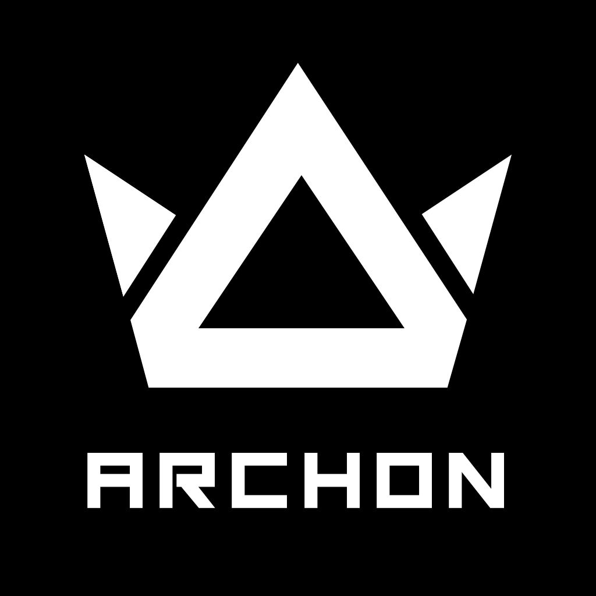

<p align="center">

</p>
<p align="center">
     &nbsp;
     <a href="https://github.com/Voidware-Prohibited/Archon/commits/master"></a>
</p>
<!--<p align="center">
     <a href="https://github.com/Voidware-Prohibited/Archon/commits/master"></a>&nbsp;
     <a href="https://github.com/Voidware-Prohibited/Archon/commits/master"></a>&nbsp;
     <a href="https://github.com/Voidware-Prohibited/Archon/commits/master"></a>&nbsp;
</p>-->
<p align="center">
     <a href="https://github.com/Voidware-Prohibited/Archon/issues"></a>&nbsp;
     <a href="https://github.com/Voidware-Prohibited/Archon/pulls"></a>&nbsp;
     <a href="https://github.com/Voidware-Prohibited/Archon/blob/master/LICENSE"></a>
</p>
<p align="center">
     <a href="https://github.com/sponsors/colorindarkness"></a>&nbsp;
     <a href="https://www.patreon.com/colorindarkness"></a>&nbsp;
     <a href="https://ko-fi.com/colorindarkness"></a>&nbsp;
     <a href="https://liberapay.com/colorindarkness"></a>
</p>

> [!NOTE]
> Following the acquisition of GitHub by Micro$lop, we have taken principled action and have begun primarily hosting code and content on [Codeberg](https://codeberg.org/Voidware-Prohibited/). Mirrors will still be maintained on [GitHub](https://github.com/Voidware-Prohibited/Archon/) and [GitLab](https://gitlab.com/Voidware-Prohibited/Archon/).

GAS-Based, Multiplayer God-Mode, Administration, Moderation and Authorization Layer.

Archon is a part of the [Target Vector](https://github.com/Voidware-Prohibited/TargetVector/) framework.

[📚Wiki](../../wiki/) • [📘Documentation](https://Archon.notion.site/2be59e501e7a4bf583437d1636bc7f2f?v=ac361eb5a6a14081892ff9a68e3e7a44/) • [📑Archon Notion](https://Archon.notion.site/2be59e501e7a4bf583437d1636bc7f2f?v=ac361eb5a6a14081892ff9a68e3e7a44/) • [🐤Twitter](https://x.com/Archon/) • [🗨️Discord](discord://colorindarkness/)

# Introduction
- Intro

# Features

> [!WARNING]
> _Archon is under heavy development, including a rewrite to utilze GAS, Modular features and new technologies. Many features may not be finished or production-ready. Use at your own risk._

- Spawn enemies, change the weather, or any other parameter with the interactive God Role, for truly Dynamic Gameplay.
- Observe, follow, audit, report and sanction players.
- Granular Definable ACL Roles and Permissions.
- Aurora Serialization support
- Abraxas Integration


# Requirements
- Unreal Engine 5.8 or later built from github Source Code
- A working UE5 C++ Integrated Developement Environment(IDE)
     - Tested: Jetbrains Rider, VS Code, Visual Studio (Windows)
     - Untested: XCode (MacOS), Jetbrains Rider, VS Code, Visual Studio (Linux)
- clang -20 13.0.1

## Engine Plugins
The following are built-in Engine plugins that are enabled in the Plugins window. Warning: some plugins may be Experimental or Beta software.
- [Gameplay Abilities](https://dev.epicgames.com/documentation/en-us/unreal-engine/API/Plugins/GameplayAbilities/)
- GameplayCameras
- GameplayTasks
- SmartObjectsModule
- GameplayBehaviorsModule
- GameplayBehaviorSmartObjectsModule
- AbilitySystemGameFeatureActions
- AIModule
- GameFeatures
- ModularGameplay
- ModularGameplayActors

## Third-Party Plugins
The following plugins require cloning or downloading into your projects `Plugins` folder.
- [Advanced Locomotion System Refactored](https://github.com/Sixze/ALS-Refactored/) 

## CI System Requirements
Systems performing Continous Intergration Workflows will have additional requirements depending on the CI solution used.
- Git
- OpenCppCoverage
- Domain Name or ngrok (For Self Hosted CI)
- Workflow Actions services and Runners configured for Forgejo/Codeberg, GitHub or GitLab
- Jenkins and Java 11 (For Jenkins)

# Installation
[Complete Installation Instructions](../..//wiki/Installation/)

**Quick Install**

1. Install and setup (if required) all dependencies
2. Clone/download Archon into your projects Plugin folder
3. (Re)Build Project with the `BuildPlugin.bat` Script or your IDE
4. Once compilation is successful you can now begin using Archon in your project

## Available Scripts
- `./BuildPlugin.bat` - Build Plugin Batch Script
- `./BuildPlugin.sh` - Build Plugin Shell Script
- `./RunAutomatedTests.bat` - Run Automated Tests Batch Script
- `./RunAutomatedTests.sh` - Run Automated Tests Shell Script

# Getting Started
[Getting Started](../..//wiki/GettingStarted/)
Classes.

```
Archon                           # Base Class.

```

Classes.

# Settings
Archon is designed to be extremely configurable by with Data Assets. Most [Settings](../..//wiki/Settings/) are centralized in the [ArchonSettings](../..//wiki/ArchonSettings/) Data Asset.

## Gameplay Ability System
Default [Character Abilities](/wiki/Settings/GameplayAbilities/) are defined by [Gameplay System Initialization Data](../..//wiki/Settings/GameplayAbilities/).

# CI
CI workflow YAML files are included for Forgejo/Codeberg, GitHub and GitLab. 

`ue-plugin-ci` Build, Test, Code Coverage, Upload to Codecov, Update Changelog, Update Status. Activated with any push.
`ue-plugin-ci-release` Build, Cook, Package, Test, Code Coverage, Upload to Codecov, Update Changelog, Update Status. Activated the a `v*` tag in the commit.
`changelog` Generates and commits CHANGELOG.md. Activated the a `v*` tag in the commit.


## Automated Testing
The provided tests can be run in an Action Workflow or run manually with RunUAT. Learn more about Unreal Engine Automated Testing in the [Run Automated Tests](https://dev.epicgames.com/documentation/unreal-engine/run-automation-tests-in-unreal-engine?lang=en-US) documentation.

- `ArchonTest`

## Code Coverage
OpenCodeCoverage will perform Code Coverage analysis and publish and XML file as a Commit Artifact, and can optionally be uploaded to a configured Codecov account. You will need to first generate an Access Token from your Codecov account and add it your Forgejo/Codeberg, GitHub or GitLab Secrets as `CODECOV_TOKEN`.

# Contributions

Contibutors and PRs are welcome! If you wish to contribute, please ensure you are synced with the latest Archon commit, message me and I'll set up permissions for you.

# License

This project is dual-licensed. It is available for absoultely free under the [MIT License](LICENSE.md) for most Individuals and Organizations. If your organization, industry or application is listed in the [Commercial License](LICENSE-Commercial.md), please [Contact Us](https://voidwarex.com/contact/).

Any git submodules are covered by their respective licenses. Content listed in the Attributions are covered by their respective licenses.

# Attributions
[ATTRIBUTIONS](ATTRIBUTIONS.md)

# Special Thanks
